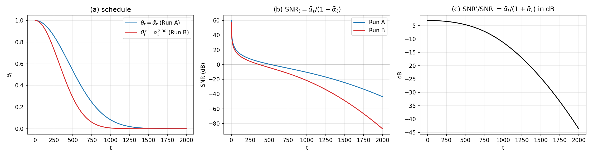
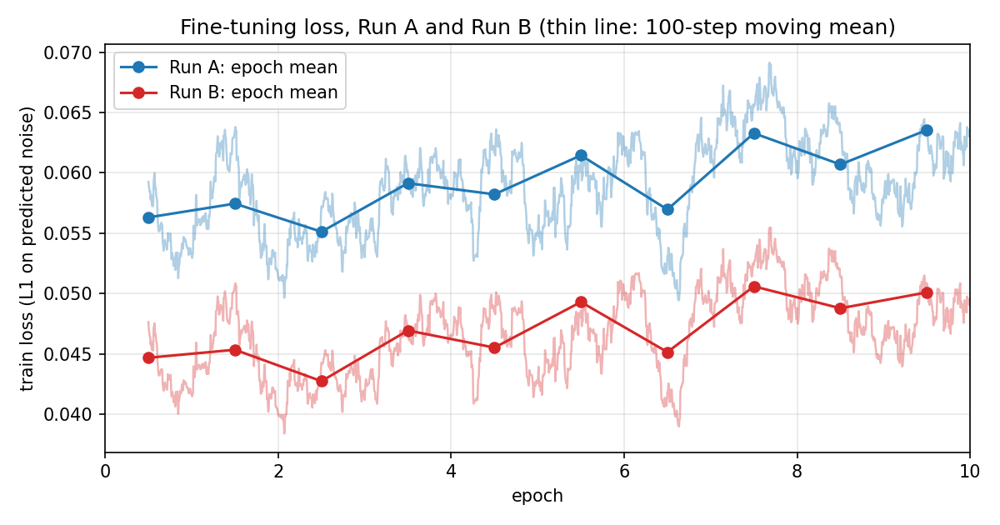
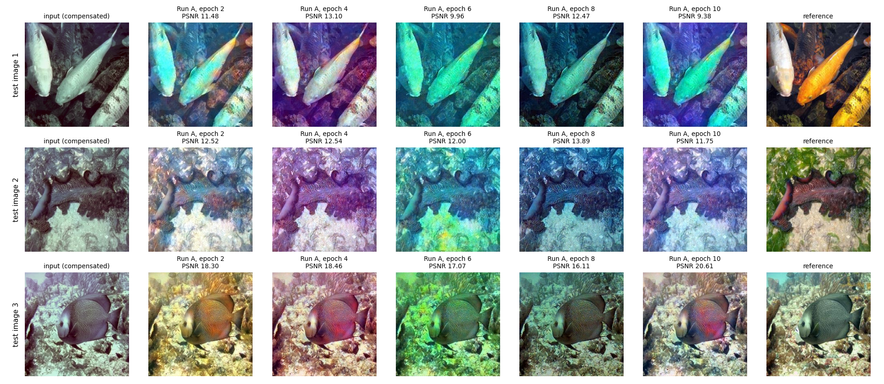
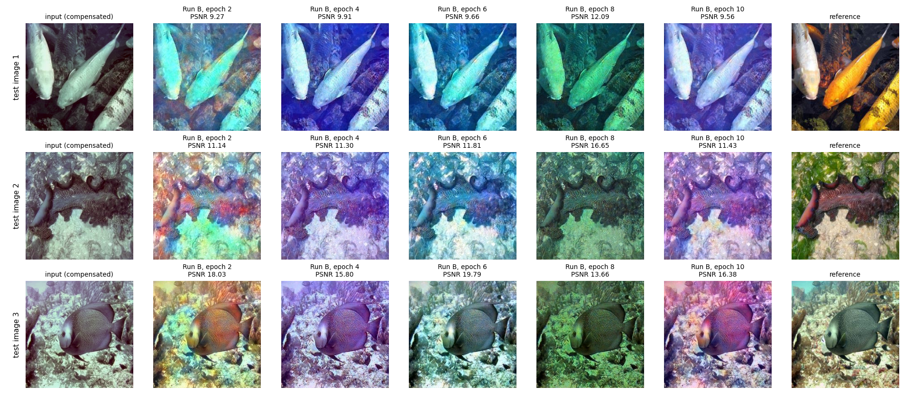
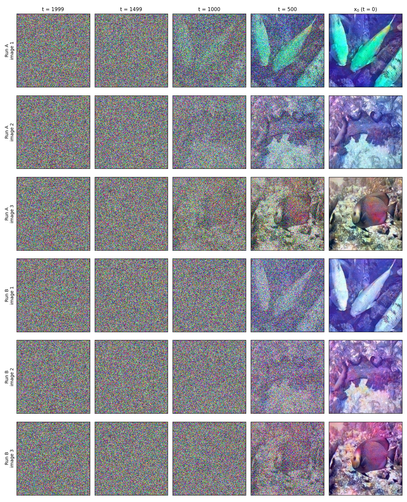
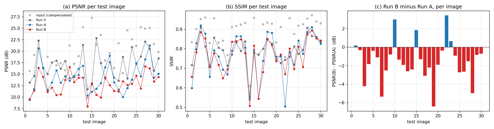
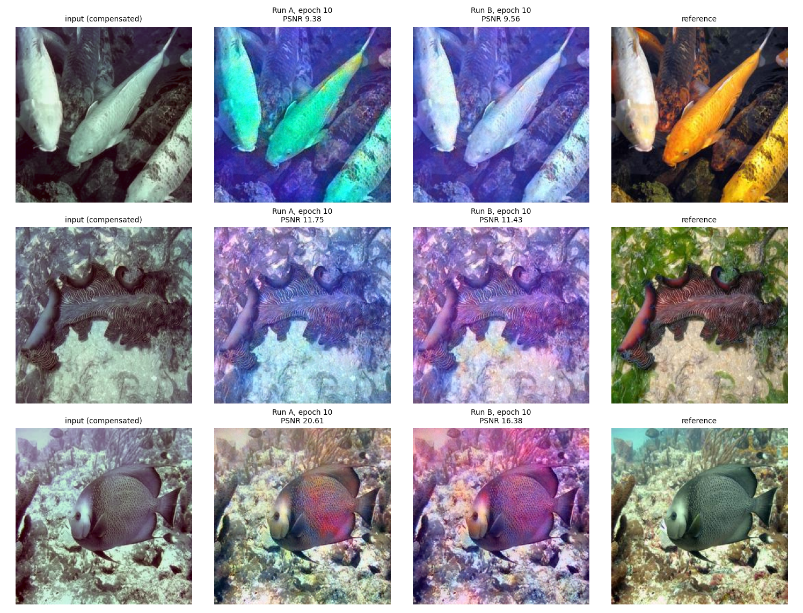

# Noise Schedule Ablation in Diffusion Models: underwater image enhancement with DiffWater

Group 25 · Foundation Models and Generative AI · Draft of 2026-10-30

> **DRAFT for team review. Delete this box before submission.** Everything below is built from the run files in `experiment/` (`RESULTS.md`, `Run0.md`, `RunA.md`, `RunB.md`) and the figures in `report/figures/` (made by `report/make_figures.py`). Items marked **[TO FILL]** need something only the team can supply:
>
> 1. **Run 0 sample images** (Figure 6): download `runs/Run0/final_eval/idx01_*` to `idx03_*` (12 files) from Run 0's Drive into `experiment/data/Run0/final_eval/`, then re-run `python3 -I report/make_figures.py`.
> 2. **Page and line numbers** for the evidence that EUVP was not in DiffWater's pretraining data (Section 2), and a check of the DiffWater citation details (authors, year) in Section 1.
> 3. **Instructor approval** of the change from UW-DiffPhys (declared) to DiffWater (used), and of the evaluation set (Sections 1 and 4).
> 4. **Library versions** beyond Python and torch (Section 4): run `!pip list | grep -i -E "scikit-image|numpy|pillow|pandas"` in a Colab session and paste it.
> 5. **Contribution statement** and signatures (Section 9).

---

## 1. Task and Model

**Task.** Paired underwater image enhancement. Given a degraded underwater RGB image (colour cast, haze, low contrast), produce the enhanced image that the dataset provides as its reference. A conditional diffusion model learns the mapping from paired examples. Images are 256 × 256.

**Model.** DiffWater, a conditional denoising diffusion probabilistic model (DDPM) for underwater image enhancement (Guan et al., *IEEE J. Sel. Topics Appl. Earth Obs. Remote Sens.*, 2024; paper: <https://ieeexplore.ieee.org/document/10365517>; code: <https://github.com/Guan-MS/DiffWater>, Apache-2.0). It is an SR3-style U-Net with 155.3 M parameters. The network input has 6 channels: the 3-channel condition (the degraded image, after the repository's colour-channel compensation) and the 3-channel noisy target. It also receives the integer timestep *t* through a sinusoidal embedding, and it predicts the noise ε with an L1 loss. Sampling is ancestral over all T = 2000 steps. We used the pretrained checkpoint `I390000_E78_gen.pth` from the `LSUI` folder of the authors' public Drive folder.

**Forward process and the native parameter θₜ.** With T = 2000 and a linear schedule β₁…β_T from 1e-6 to 1e-2:

- αₜ = 1 − βₜ (per-step retention) and **ᾱₜ = α₁α₂⋯αₜ** (cumulative retention).
- A noisy sample is x_t = √ᾱₜ · x₀ + √(1 − ᾱₜ) · ε, with x₀ the clean target image and ε ~ N(0, I).
- The network ε_θ(x_t, c, t) takes the noisy target x_t, the condition c and the timestep t, and is trained to predict ε.
- **θₜ = ᾱₜ** is the quantity the model's training and sampling formulas use directly (the posterior coefficients are derived from it). Run A uses θₜ; Run B uses θₜˣ = ᾱₜ^x with **x = 2.00**.

**Deviation from the declaration.** The Phase 1 declaration named UW-DiffPhys (arXiv 2409.18476). Its pretrained checkpoint is on a Google Drive restricted to approved accounts, and we could not get access; training it from scratch on a Colab T4 was not feasible (about 55 minutes per epoch on a colleague's attempt). DiffWater is the same kind of model (conditional DDPM, paired underwater enhancement, θₜ = ᾱₜ) with public weights. The task, dataset, θₜ and x = 2.00 are unchanged; the image size is 256 (DiffWater's native size) instead of the declared 128. **[TO FILL: instructor approval.]**

## 2. Dataset and Verification

**Dataset.** EUVP, *Enhancing Underwater Visual Perception* (Islam, Xia, Sattar; paper <https://arxiv.org/abs/1903.09766>; release <https://irvlab.cs.umn.edu/resources/euvp-dataset>; Kaggle copy used: <https://www.kaggle.com/datasets/pamuduranasinghe/euvp-dataset>). We use the paired subsets **Underwater Dark** (5,550 training pairs) and **Underwater Scenes** (2,185 training pairs); the Underwater ImageNet subset is excluded. All 7,735 pairs matched by file name. Images are resized to 256 × 256 (LANCZOS). The pairs fit the task: each has a degraded image and an enhanced reference of the same scene. The references are the dataset's own enhanced counterparts, not physical ground truth (this matters for the metrics, Section 7).

**What we used.** 800 training pairs (575 Dark + 225 Scenes) and 30 held-out test pairs, all Dark (Section 4). The EUVP `validation` folders were not used: they contain no reference images (1 of 570 names matches a training reference) and hold files byte-identical to training files (10 Dark, 1 Scenes).

**Evidence that EUVP was not used to pretrain DiffWater.** **[TO FILL: link, page number and line number from the paper PDF.]** What we have so far, to be confirmed against the PDF:

- The repository stores pretrained weights in per-dataset folders (`LSUI`, `UIEB`); we used the `LSUI` one.
- The repository lists LSUI, UIEB, SQUID and U45 as its data. EUVP is not among them as far as we read.
- Domain argument (option b of the declaration): EUVP images come from the authors' own cameras and public videos (EUVP paper, Section 3.3), while LSUI and UIEB are web-collected sets.
- **A caveat we cannot close yet:** 13 of the 30 test names and 2,399 of the 7,700 training-pool names match an ImageNet-style naming pattern (`..._nXXXXXXXX_...`). If those images originate from ImageNet or Flickr, some overlap with web-collected pretraining sets cannot be excluded. We did not verify where they come from.

## 3. Schedule Analysis

**θₜ ∈ (0, 1) for all t.** Every βₜ lies in [1e-6, 1e-2], so every αₜ = 1 − βₜ lies in (0.99, 1). A finite product of numbers in (0, 1) lies in (0, 1), so ᾱₜ ∈ (0, 1) and ᾱₜ is strictly decreasing. Raising a number in (0, 1) to the power x = 2 keeps it in (0, 1) and preserves the order, so ᾱₜ² ∈ (0, 1) and is also strictly decreasing. Computed: ᾱ₁ = 0.999999, ᾱ_T = 4.386e-5 (A) and ᾱ_T² = 1.924e-9 (B), both positive and representable in float32. The script asserts this on every run (`apply_and_check_schedule`).

**Figure 1.** (a) θₜ and θₜˣ on the same axes; (b) SNR of both; (c) the ratio SNR′/SNR.



**What changes in the forward process when x > 1.** Because ᾱₜ < 1, ᾱₜˣ < ᾱₜ at every t > 0, and the gap grows with x.

- A noisy sample becomes x_t = ᾱₜ^(x/2) · x₀ + √(1 − ᾱₜˣ) · ε. The signal coefficient shrinks faster and the noise variance 1 − ᾱₜˣ is larger at the same t.
- The per-step coefficients follow from the new product: α′ₜ = ᾱₜˣ / ᾱₜ₋₁ˣ = αₜˣ, so β′ₜ = 1 − (1 − βₜ)ˣ ≈ x·βₜ. For x = 2, β′ₜ = 2βₜ − βₜ², which runs from 2.0e-6 to 0.0199 (A: 1e-6 to 0.01). The image is destroyed in fewer steps.
- Numbers (t is the 1-based step; values from the computed schedule):

| | A (θₜ) | B (θₜ²) |
|---|---|---|
| ᾱ at t = 250 / 500 / 1000 | 0.8545 / 0.5339 / 0.0814 | 0.7301 / 0.2851 / 0.0066 |
| first t with θₜ (A) or θₜ² (B) below 0.5, i.e. SNR below 0 dB | 527 | 373 |
| steps with ᾱ < 0.01 (almost pure noise) | 645 of 2000 (32 %) | 1041 of 2000 (52 %) |
| largest 1/√ᾱ (error amplification in x̂₀ from ε̂) | 151 | 22,800 |

**Signal-to-noise ratio.** SNRₜ = ᾱₜ / (1 − ᾱₜ). For the power x, SNR′ₜ = ᾱₜˣ / (1 − ᾱₜˣ). For x = 2:

SNR′ₜ = ᾱₜ² / ((1 − ᾱₜ)(1 + ᾱₜ)) = SNRₜ · ᾱₜ / (1 + ᾱₜ).

The factor ᾱₜ/(1 + ᾱₜ) is below 1/2, so at every t the SNR is at least 3 dB lower. The loss is 3.0 dB at t = 1, 4.6 dB at t = 500, 11.2 dB at t = 1000 and 43.6 dB at t = T (Figure 1c). The same timestep index therefore means a noisier input in B than in A.

## 4. Experimental Setup

**Dataset preparation** (notebook Step 3; the split is identical in every session and checked by fingerprints).
1. Match `trainA` (degraded) and `trainB` (reference) by file name in the Dark and Scenes folders, and index every image by MD5 and a 64-bit difference hash.
2. **Test set:** shuffle the Dark pairs with seed 1234, take the first 30 that are not byte-identical to each other, and sort them. Saved as `test_split_dark30.json` (split fingerprint `f8cc4714a30c`).
3. **Training pool:** all other Dark and Scenes pairs, minus exact duplicates (5 found) and near-duplicates (Hamming distance ≤ 6 of 64 bits; 0 found) of any test image.
4. **Training set:** shuffle the pool with seed 1234 and take 800 pairs: 575 Dark and 225 Scenes (the pool's natural proportion; fingerprint `6a9f33de995c`).
5. Resize all images to 256 × 256 (LANCZOS) and save as PNG.

**Split.** Train 800 · validation: none · test 30. Same-scene-different-frame correlation between training and test images is not removed; the EUVP release has the same limitation.

**Fine-tuning hyperparameters (identical for Run A and Run B).**

| Item | Value |
|---|---|
| Starting weights | `I390000_E78_gen.pth`, the same file for both runs |
| Optimizer | Adam (fresh state), learning rate 1e-5 |
| Batch size | 4 (800 pairs → 200 steps per epoch) |
| Epochs | 10 (2000 optimisation steps) |
| Loss | L1 between predicted and true noise, as in the repository |
| EMA, augmentation | none (the repository's training path has neither) |
| Seed | 1234. Each epoch is seeded with 1234 + epoch, which fixes the data order, the timesteps and the noise. Test image k is sampled with seed 1234 × 1000 + k. |
| Sampler | ancestral, all 2000 steps, same code and seeds in Run 0, A and B |
| Exponent | A and Run 0: 1. B: `X = 2.00` (named constant at the top of `finetune.py`) |

**Validation during fine-tuning.** There is no separate validation set. We monitored the training loss (every epoch, CSV per run) and generated samples for the **first 3 of the 30 test images** at epochs 2, 4, 6, 8 and 10. These samples were only looked at; no checkpoint, epoch or hyperparameter was chosen from them, and the evaluated model is the epoch-10 model in both runs. This does mean the 3 sample images are part of the test set.

**Test set use.** After training, all 30 test images are sampled with the epoch-10 model of each run (Run 0: with the pretrained weights) and scored.

**Metric.** PSNR and SSIM from scikit-image (`data_range=255`, `channel_axis=2`) between the generated image and the reference, on 256 × 256 8-bit RGB. We use them because they are the standard full-reference fidelity measures for paired enhancement benchmarks and need no extra model.

**Environment.** Colab, Tesla T4, Python 3.13.16, torch 2.11.0+cu130, DiffWater commit `7db68f34060bbf1d7c5b8153664fb16a3dcda1ae`, `finetune.py` md5 `38c97203e8ccafdfb80cb2be74b0bb3a` (checked at launch in every session). **[TO FILL: scikit-image, numpy, pillow versions.]**

**Execution notes (deviations from a single uninterrupted run).** Run 0 and Run B each ran in one session. Run A ran in four Colab sessions because of disconnects and usage limits. Session 1 trained epochs 1 to 10, but its last resume file did not reach Drive, so session 2 resumed from epoch 8 and trained epochs 9 and 10 again (epoch 9 loss 0.06070 both times; epoch 10 0.06372 and 0.06355). Test images 25 to 30 were sampled in sessions 3 and 4 in other Google accounts, resuming from the same epoch-10 file. Weights, seeds, script and data fingerprints were identical in every session; full details are in `experiment/RunA.md`.

## 5. Implementation

**Files.** `finetune.py` (new; contains the training loop, the sampler wrapper, logging and the schedule change). No DiffWater file was edited on disk. `finetune.py` replaces one method at run time, `GaussianDiffusion.set_new_noise_schedule` in `model/ddpm_modules/diffusion.py`, with a copy in which five lines are marked `# MODIFIED` (lines 86, 87, 89, 90, 91) and everything else in the file is marked `# ADDED`. The exponent is the named constant `X = 2.00` at line 46.

**Original (DiffWater `model/ddpm_modules/diffusion.py`, lines 114–116):**

```python
alphas = 1. - betas
alphas_cumprod = np.cumprod(alphas, axis=0)
alphas_cumprod_prev = np.append(1., alphas_cumprod[:-1])
```

**Modified (`finetune.py`, lines 84–91):**

```python
alphas = 1. - betas
alphas_cumprod = np.cumprod(alphas, axis=0)
if EXPONENT != 1.0:                                           # MODIFIED
    alphas_cumprod = alphas_cumprod ** EXPONENT               # MODIFIED  theta_t -> theta_t ** x
alphas_cumprod_prev = np.append(1., alphas_cumprod[:-1])
if EXPONENT != 1.0:                                           # MODIFIED
    alphas = alphas_cumprod / alphas_cumprod_prev             # MODIFIED  per-step alpha_t implied by new product
    betas = 1. - alphas                                       # MODIFIED  per-step beta_t implied by new product
```

All other schedule arrays (square roots, posterior variance and mean coefficients) are computed from `alphas_cumprod` further down, unchanged, so training noising and sampling both use the new schedule. Line 289 installs the replacement (`# MODIFIED (monkeypatch)`).

**How we verified that Run B used θₜˣ and not θₜ.**
1. **A trap we found and fixed.** The schedule arrays are stored inside the checkpoint's `state_dict`, so loading the pretrained checkpoint silently overwrites a modified schedule with the original one. A demonstration in the notebook (Step 5) shows two buffer values 0.81 and 0.25 turning back into 0.90 and 0.50 after `load_state_dict`. `finetune.py` therefore re-applies the schedule after every load.
2. **An assertion after every load** (`apply_and_check_schedule`): the buffers must equal ᾱₜ^EXPONENT within 1e-5 relative tolerance, lie in (0, 1) and decrease. The run stops otherwise.
3. **The log prints the schedule.** Run B's first lines read `exponent 2.0, abar_last 1.924e-09, beta_min 2.0e-06, beta_max 0.0199`; Run A's read `exponent 1.0, abar_last 4.386e-05, beta_min 1.0e-06, beta_max 0.01`. These are the values computed in Section 3, and `run_config.json` stores them.
4. **The pictures agree**: at the same t, B's trajectory images are noisier (Figure 4).

## 6. Results

### Run 0: pretrained model, no fine-tuning

**[TO FILL: Figure 6 with the Run 0 column.]** Run 0 outputs for all 30 test images are on Drive (`runs/Run0/final_eval/`). Until the three sample images are copied, Figure 6 below shows the input, Run A, Run B and the reference only.

### Figure 2: fine-tuning loss, Run A and Run B

The thin lines are 100-step moving means; the dots are the per-epoch means that are in the CSV files (`train_log.csv` of each run).



### Figures 3a and 3b: generated samples at epochs 2, 4, 6, 8, 10 (test images 1 to 3)





| Epoch | Run A (PSNR / SSIM, mean of 3 images) | Run B |
|---|---|---|
| 2 | 14.10 / 0.780 | 12.81 / 0.701 |
| 4 | 14.70 / 0.800 | 12.34 / 0.771 |
| 6 | 13.01 / 0.706 | 13.75 / 0.759 |
| 8 | 14.16 / 0.762 | 14.13 / 0.742 |
| 10 | 13.91 / 0.771 | 12.46 / 0.774 |

### Figure 4: inference trajectories (final models)

The noisy sample x_t during the reverse process at t = 1999, 1499, 1000, 500 and the final x₀, for test images 1 to 3.



### Table: test-set scores (30 held-out Dark pairs, output vs reference)

| Condition | PSNR (dB), mean ± sd | SSIM, mean ± sd |
|---|---|---|
| Input (colour-compensated), no model | 20.65 ± 4.13 | 0.889 ± 0.081 |
| **Run 0** (pretrained) | **16.91 ± 3.07** | **0.792 ± 0.071** |
| **Run A** (fine-tuned, θₜ) | **14.36 ± 3.02** | **0.770 ± 0.112** |
| **Run B** (fine-tuned, θₜ², x = 2.00) | **12.85 ± 2.19** | **0.763 ± 0.097** |

Paired differences, per image over the same 30 images (first minus second); |mean| below 2 standard errors counts as not distinguishable from zero:

| Comparison | Metric | Mean difference | s.e. | Second run higher on | Verdict |
|---|---|---|---|---|---|
| Run A − Run 0 | PSNR (dB) | −2.55 | 0.53 | 6 / 30 | distinguishable |
| Run A − Run 0 | SSIM | −0.022 | 0.014 | 14 / 30 | not distinguishable |
| Run B − Run 0 | PSNR (dB) | −4.06 | 0.54 | 3 / 30 | distinguishable |
| Run B − Run 0 | SSIM | −0.029 | 0.012 | 11 / 30 | borderline (2.4 s.e.) |
| **Run B − Run A** | **PSNR (dB)** | **−1.51** | **0.40** | **5 / 30** | **distinguishable** |
| **Run B − Run A** | **SSIM** | **−0.007** | **0.008** | **9 / 30** | **not distinguishable** |



### Figure 6: the three conditions side by side (test images 1 to 3)



## 7. Analysis

**Which run produced better outputs.** On PSNR, Run A is better than Run B by 1.51 dB (standard error 0.40; A is higher on 25 of 30 images). On SSIM the two runs are not distinguishable. So replacing ᾱₜ by ᾱₜ² made the fine-tuned model's outputs measurably less close to the references, and did not change structural similarity measurably.

**At which checkpoint the difference first became visible.** We cannot name a checkpoint. On the three sample images, B's PSNR was already 1.3 dB below A's at epoch 2 (12.81 against 14.10), but at epoch 6 B was higher, at epoch 8 the two were equal, and at epoch 10 B was 1.45 dB lower again. In both runs the outputs of the same image change colour from checkpoint to checkpoint (cyan, purple, green casts in Figures 3a and 3b), and a single image's PSNR moves by up to about 5 dB between checkpoints of the same run (for example test image 2 in Run B, 11.1 to 16.7 dB), which is larger than the A-versus-B gap. Three images are too few to separate a schedule effect from this checkpoint-to-checkpoint colour swing. The 30-image evaluation at epoch 10 is the reliable comparison. What is visible from the start is a property of the schedule, not of training: at the same t, B's x_t is noisier and shows structure later (at t = 500, image structure is clearly visible in A and still faint in B, Figure 4).

**Mechanistic explanation from the schedule mathematics.** The following are explanations consistent with the schedule mathematics and with what we observe. We did not test them one by one.

1. *The pretrained time conditioning no longer matches.* The pretrained network learned that timestep index t corresponds to SNR_A(t). In B the same index corresponds to an SNR that is lower by ᾱₜ/(1 + ᾱₜ): 3 dB at t = 1, 11.2 dB at t = 1000, 43.6 dB at t = T (Section 3). Starting from the pretrained weights, the network therefore receives noise levels that it associates with a different t. Fine-tuning has to re-learn that mapping, and 2000 steps at learning rate 1e-5 can only do so partly.
2. *Fewer steps in the informative range.* In B, 52 % of the steps are almost pure noise (ᾱ < 0.01) against 32 % in A, and the SNR drops below 0 dB at t = 373 instead of 527. Global colour and layout are typically decided early in the reverse process, where little signal remains, so B has fewer steps in which the image can take shape.
3. *Error amplification.* The reverse step estimates x̂₀ = (x_t − √(1 − ᾱₜ) · ε̂) / √ᾱₜ. An error in the predicted noise is multiplied by √((1 − ᾱₜ)/ᾱₜ), which approaches 1/√ᾱₜ at large t. That factor reaches 22,800 in B against 151 in A, and the clip to [−1, 1] hides the effect but does not remove it. This is consistent with the global colour casts that dominate the errors in both runs; we did not find clearly more erratic colour in B than in A on the three sample images.

A cheap test of explanation 1 would be to remap B's timestep input so that the pretrained network sees the SNR it expects. We did not run it.

**How Run 0 compares with Run A and Run B, and what it says about fine-tuning on this dataset.** Run 0 scores highest (PSNR 16.91), then A (14.36), then B (12.85). Fine-tuning for 10 epochs on 800 EUVP pairs did not improve the held-out EUVP Dark images under these metrics: it lowered PSNR by 2.55 dB (s.e. 0.53), and SSIM by 0.022, which is not distinguishable from zero. The size of this fine-tuning effect is larger than the schedule effect (1.51 dB).

- The training loss did not fall during fine-tuning. It rose from 0.0563 to 0.0636 in A and from 0.0447 to 0.0501 in B (about 12 % to 13 %; an epoch mean has a noise of roughly 0.003, so the rise is modest). Runs A and B use the same per-epoch seeds, hence the same batches, timesteps and noise, so their curves move in parallel (Figure 2) and do not confirm each other independently.
- Our reading: the fine-tune moved the model away from a better solution instead of toward one. Candidates are a learning rate (1e-5) above the 3e-6 the authors used, a fresh Adam state without warm-up, a batch of only 4, and EUVP references whose colour style differs from the pretraining data. We ran no learning-rate sweep and cannot say which.
- **The "out-of-distribution" premise is not established for our model.** The assignment frames the dataset as outside the pretraining distribution; for DiffWater we still lack the page and line evidence, and the ImageNet-style names (Section 2) leave a possible overlap open.
- **Even the unprocessed input beats every model.** The colour-compensated input scores 20.65 dB against 16.91 for the best model. Full-reference PSNR and SSIM reward staying close to the reference; a model that visibly shifts colours is penalised heavily when the reference is itself a stylised enhancement. In Figures 3a and 3b, for example, the centre fish of test image 1 is white in the input and orange in the reference, and comes out cyan in Run A and pale blue in Run B at epoch 10. These metrics therefore measure fidelity to EUVP's references more than perceived quality.

**Limits of this study.** One seed, one exponent (x = 2.00), one fine-tuning budget (2000 steps), one learning rate, 30 test images from one subset, and a model that was not the declared one. The A-versus-B result applies to this setting.

## 8. Takeaway

- **The assignment is a controlled comparison, not a search for a better enhancer.** We did the comparison under identical conditions (same checkpoint, data, order, seeds, hyperparameters, sampler and test images), with Run 0 and Run A as controls.
- **Result:** raising the schedule parameter to the power 2 lowered PSNR by about 1.5 dB relative to the original schedule after the same short fine-tune, without a measurable SSIM change; and fine-tuning itself, with our settings, did not improve on the pretrained model.
- **A schedule change is not a drop-in change for pretrained weights.** The network's timestep input is tied to the schedule it was trained with. Changing the schedule changes what each t means, and the network has to relearn it.
- **A control run is necessary.** Comparing B only with the pretrained model would have attributed the whole 4 dB drop to the schedule; Run A shows that more than half of it comes from the fine-tune itself.
- **Engineering lessons:** schedule buffers live inside the checkpoint and must be re-applied after loading; fingerprints on the data split and the script catch silent differences between sessions; per-image checkpoints make long evaluations survive disconnects.

## 9. Contribution Statement

| Member | Roll No. | Responsibility | Signature |
|---|---|---|---|
| Sameer Sarkar | M26AI1107 | **[TO FILL]** | |
| Joydeep Roy | M26AI1053 | **[TO FILL]** | |
| Krishnendu Halder | M26AI1054 | **[TO FILL]** | |
| Samanwita Patra | M26AI1106 | **[TO FILL]** | |

---

## Appendix: where each deliverable is

| Requirement | Location |
|---|---|
| Code with `# MODIFIED` / `# ADDED`, `X` at the top | `finetune.py` |
| Commands, seed, environment | `README.md` (to be rewritten for the final runs); `experiment/RunA.md`, `RunB.md`, `Run0.md` |
| Loss CSV per run (epoch, train_loss) | `experiment/data/RunA/train_log.csv`, `experiment/data/RunB/train_log.csv` |
| Samples at 5 epochs, 3 images, both runs | `experiment/data/RunA/samples/`, `experiment/data/RunB/samples/` (Figures 3a, 3b) |
| Trajectories at 5 timesteps, 3 images, both runs | `idx*_traj.png` in the same folders (Figure 4) |
| Test-set scores per image | `experiment/data/Run0/`, `RunA/`, `RunB/eval_metrics.csv`; compiled in `experiment/RESULTS.md` |
| Decisions and deviations | `experiment/DECISIONS.md` |
